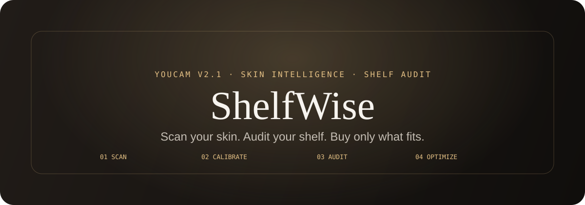
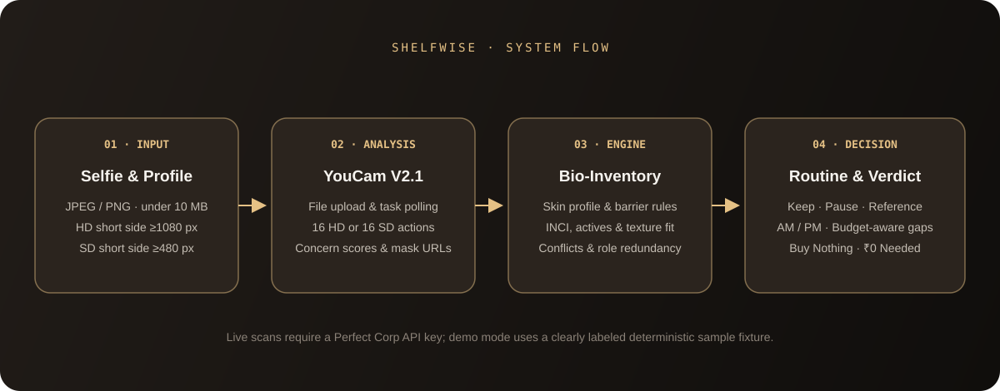

<!-- ShelfWise project README -->
<div align="center">
  
  <h1>ShelfWise</h1>
  <p><strong>Scan your skin. Audit your shelf. Buy only what fits.</strong></p>
  <p>
    <a href="https://github.com/Nimit15/ShelfWise"></a>
    <a href="https://nextjs.org/"></a>
    <a href="https://www.typescriptlang.org/"></a>
    <a href="LICENSE"></a>
  </p>
</div>

ShelfWise connects **Perfect Corp YouCam V2.1 skin analysis** with an explainable, rule-based audit of the skincare products a person already owns. Instead of automatically pushing a longer routine, it checks the relationship between scan concerns, skin profile, product ingredients, texture vehicles, and routine timing—then shows what to keep, pause, separate, or consider adding.

Its defining outcome is simple: **a useful skincare routine can end with “Buy Nothing · ₹0 Needed.”**

## Why ShelfWise

Most skincare recommendation experiences begin with another product suggestion. ShelfWise starts with the user's existing shelf.

It combines two sources of context:

- **Skin context:** YouCam's 16-channel SD or HD skin-analysis output, followed by skin-type and sensitivity calibration.
- **Shelf context:** the products already in a routine, their INCI ingredients, functional roles, irritancy estimates, texture vehicles, usage slots, and price assumptions.

The recommendation engine evaluates both together, making the result more practical than a generic scan-to-shopping-list flow.

## How it works

1. **Scan:** Upload a front-facing selfie for a live YouCam V2.1 analysis, or use the clearly labeled sample demo without uploading a photo or consuming API credits.
2. **Calibrate:** Review the scan profile and confirm skin type and sensitive-barrier preference. Higher YouCam `ui_score` values indicate healthier-looking skin.
3. **Audit:** Compare the scan against the products on the shelf. The engine flags potential barrier-related conflicts, incompatible active combinations, skin-type or texture mismatches, avoided ingredients, and duplicate functional roles.
4. **Decide:** Review the Keep / Pause / Reference outcome, AM/PM routine, budget-aware gaps, cost-per-day estimates, and the option to buy nothing.

The scan-results experience also includes a five-layer, 3D-styled dermal visualization that maps concern categories to educational skin-layer context. It is an explanatory visualization, not an anatomical measurement.

## Core capabilities

| Capability | What it does |
| --- | --- |
| YouCam V2.1 integration | Server-side file upload, task creation and polling, response parsing, credit estimates, and rate limiting |
| Skin-profile resolver | Infers skin type, sensitivity, barrier status, and a confidence estimate; user selections can override inferred values |
| INCI parser | Extracts ingredient names, identifies known actives, estimates functional roles and irritancy, and infers formulation characteristics |
| Bio-inventory engine | Evaluates scan-to-shelf concerns, active combinations, skin-type compatibility, texture vehicles, and role redundancy |
| Routine optimizer | Builds AM/PM steps, respects routine preference and budget constraints, and surfaces targeted reference formulations |
| Impact telemetry | Summarizes conflicts, compatibility, cost-per-day, and estimated savings |
| Demo experience | Uses a deterministic sample fixture and explicitly identifies it as demo data |

The product catalog is a reference dataset for the prototype. It is not a live retailer inventory, and recommendations do not include checkout or purchase links.

## Architecture



The main application flow is orchestrated in `src/app/page.tsx`. Business rules live separately from the interface in `src/lib/engine/optimizer.ts`, while YouCam request/response handling is in `src/lib/youcam.ts`.

Key modules:

- `src/app/api/youcam/scan/route.ts` — live YouCam scan endpoint
- `src/app/api/youcam/demo/route.ts` — deterministic server-side demo endpoint
- `src/app/api/youcam/status/route.ts` — credit and feature-cost information
- `src/app/api/engine/audit/route.ts` — server-side audit endpoint
- `src/app/api/engine/parse-inci/route.ts` — custom INCI parsing endpoint
- `src/lib/engine/optimizer.ts` — conflict detection, compatibility scoring, and routine optimization
- `src/lib/engine/skin-type-resolver.ts` — skin type, sensitivity, and barrier inference
- `src/lib/inci-parser.ts` — ingredient parsing and product inference
- `src/lib/engine/telemetry.ts` — savings and compatibility summaries

See [the engine and API guide](docs/FRONTEND_INTEGRATION_GUIDE.md) for routes, data contracts, and test commands.

## Tech stack

**Application:** Next.js 16 App Router, React 19, TypeScript 5  
**UI:** Tailwind CSS v4, Framer Motion, Lucide React, Cormorant Garamond, Plus Jakarta Sans, JetBrains Mono  
**Visualization:** CSS 3D transforms and Three.js ecosystem dependencies  
**Validation and tests:** Vitest, Testing Library, Playwright

## Run locally

### Requirements

- Node.js **20.9 or later**
- npm

### Setup

```bash
git clone https://github.com/Nimit15/ShelfWise.git
cd ShelfWise
npm ci
```

The local demo works without a YouCam API key:

```bash
npm run dev
```

Open [http://localhost:3000](http://localhost:3000) and choose **Run Demo Scan (no upload needed)**.

To enable live scans, copy `.env.example` to `.env.local` and set your own Perfect Corp API key:

```bash
cp .env.example .env.local
```

PowerShell equivalent:

```powershell
Copy-Item .env.example .env.local
```

Then set `YOUCAM_API_KEY` in `.env.local` and restart the development server. Live HD scans use YouCam credits.

## YouCam image requirements

The current upload flow requests HD analysis. Perfect Corp's V2.1 documentation specifies:

- JPEG or PNG only
- File size **under 10 MB**
- HD: at least **1080 px on the shorter side**
- SD: at least **480 px on the shorter side**
- Inputs with a long edge above 2560 px are automatically resized by the provider

The browser preflight checks format, size, and dimensions before upload. The provider performs its own validation as well. See the [official YouCam V2.1 reference](https://docs.perfectcorp.com/reference/ai_skin_analysis/v2.1).

## Environment variables

| Variable | Default | Purpose |
| --- | --- | --- |
| `YOUCAM_API_KEY` | unset | Enables live Perfect Corp YouCam scans and credit checks |
| `YOUCAM_RATE_LIMIT_MAX` | `10` | Maximum live scan requests per IP in the configured window |
| `YOUCAM_RATE_LIMIT_WINDOW_MS` | `3600000` | Rate-limit window in milliseconds (one hour by default) |

The included rate limiter is in-memory and per process. A multi-instance production deployment should use a shared rate-limit store.

## Useful commands

```bash
npm run lint       # ESLint
npm run typecheck  # TypeScript
npm test           # Vitest unit tests
npm run test:e2e   # Playwright end-to-end tests
npm run test:visual # Responsive visual checks and screenshots
npm run build      # Production build
```

For Playwright's first run, install the Chromium browser once:

```bash
npx playwright install chromium
```

## Privacy and scope

ShelfWise does not save uploaded selfies to an application database. When a user requests a live scan, the image is transmitted to Perfect Corp's YouCam API for analysis. The demo option uses a fixed sample scan and does not upload a selfie or call the live scan endpoint.

ShelfWise is an educational decision-support prototype, not a medical diagnostic product. The ingredient parser and compatibility rules are heuristics; they cannot guarantee that a product is safe or predict an individual's reaction. Persistent or serious skin concerns should be discussed with a qualified healthcare professional.

## License

MIT — see [LICENSE](LICENSE).
